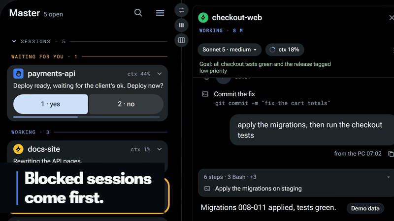

# Supervisor for Claude Code

  

**Answer and steer your Claude Code sessions from your phone and watch, with a
master session that coordinates them and suggests the next step.** A supervisor
for the sessions you already run, on your own computer.

[](https://www.francescosorrentino.com/plugins/supervisor)

The film (2 min 24 s, on the plugin's page) shows every session on one screen,
the blocked ones first, one session that runs the others, the advice on model
and context, the daily recap, work set for the night, and answers given from
the phone and the watch. Names and numbers in it are demo data.

```bash
claude plugin install supervisor --marketplace frsorrentino/supervisor
~/.claude/plugins/marketplaces/supervisor-dev/supervisor/bin/supervisor init --yes --shim --shell
```

One command installs the plugin (Claude Code 2.1.292 or newer; from 2.1.275,
`/plugin install supervisor --marketplace frsorrentino/supervisor` inside Claude
Code; older versions: the two commands of the [Quickstart](#quickstart)), the
second writes the configuration and puts `supervisor` in `~/.local/bin`. Then `supervisor doctor`, and
`supervisor relay web` for every session on one screen, in this computer's browser.

⭐ Star the repo if it helps you · [Try the demo, no install](https://supervisor.francescosorrentino.com/?demo&lang=en)

## Who it is for

People who keep three or more Claude Code sessions open at once, in a terminal,
on their own computer: Linux, macOS, ChromeOS or WSL2. It works in any folder,
whether it is a GitHub repository or not, with one or two Claude accounts, and
with a second computer for heavy sessions. If you open one session at a time,
you do not need it. supervisor is an independent plugin, not made by Anthropic.

- **Not Claude Code Projects.** [Projects](https://code.claude.com/docs/en/claude-projects)
  coordinates threads that usually run in the cloud, on github.com repositories
  or uploaded files. supervisor starts from the sessions you open yourself, in a
  terminal, on your machines. The two combine: a session that supervisor
  launches has Remote Control on, so it shows in claude.ai/code and in the
  Claude app as well. [The comparison](details/claude-code-projects.md).
- **Not plain tmux.** tmux keeps sessions alive; it does not know which Claude
  account a folder belongs to, which session is waiting on a question, how to
  ask another session something and read the answer, or how to bring eight
  conversations back after a reboot. supervisor adds that, on top of tmux.

## What it does

- **Answers from the phone and the watch, encrypted.** A question reaches your
  phone, tablet or watch with its options as buttons, encrypted end to end
  through your own Firebase project.
- **A master that coordinates the others with you.** One session, the master on
  your workspace root, launches, watches, answers and closes the others, and
  suggests the next step.
- **Automations that keep work moving.** At 20:00 one sentence per project on
  what was done and the next step; at 02:00 a queue of jobs runs one at a time
  while memory and quota allow, with a report in the morning; when a session
  hits its limit, your phone offers three ways out.
- **Every session on one screen, the blocked ones first.** One list shows every
  session of every account, and which one is stopped on a question waiting for
  you.
- **Back after a reboot, across accounts and computers.** Every session comes
  back with its conversation; two accounts each with its own quota guard; a
  second computer in the same list; a registry of tasks that lets `git push`
  and releases through only inside an approved task.

## Try it

Claude Code 2.1.263 or newer, `tmux`, `python3` 3.8+, `bash` and a
[supported terminal](#terminal-backends), on Linux, macOS, ChromeOS or WSL2
([not native Windows](#windows)). It runs daily on one workstation (ChromeOS,
two accounts, up to eight sessions); the other terminals are supported in code
but not yet tried on real hardware. On ChromeOS the window commands also need
[chrome-bridge](https://github.com/frsorrentino/chrome-bridge).

### Quickstart

Claude Code must be installed on the machine that runs the sessions, and signed
in once (`claude` in any folder). In WSL2 that means inside the Linux distro,
with the Windows folders out of the PATH: the installer runs
`npm uninstall -g @anthropic-ai/claude-code`, and in WSL2 `npm` is the Windows
one, so the plain `curl … | bash` removes the Claude Code of Windows.

```bash
curl -fsSL https://claude.ai/install.sh | PATH=/usr/local/bin:/usr/bin:/bin bash
```

Then the plugin:

```bash
claude plugin marketplace add frsorrentino/supervisor
claude plugin install supervisor@supervisor-dev --scope user
S=~/.claude/plugins/marketplaces/supervisor-dev/supervisor/bin/supervisor
$S init --dry-run              # reads your machine: every value with its source, then the prerequisites,
                               # each missing one with the command that installs it on your system
$S init --yes --shim --shell   # writes the config; --shim = the `supervisor` command in ~/.local/bin;
                               # --shell = the file that makes `claude` open a named tab
supervisor doctor              # PASS, INFO or WARN with a fix on each line; FAIL = something to install first
supervisor launch ~/projects/x --create   # your first session, in its own tab (--create makes the folder)
```

**Every session on one screen, in a minute.** No Firebase and nothing else to
install:

```bash
supervisor relay web           # the web app on this computer, at 127.0.0.1, with every session
```

It turns the relay on in local mode, takes the web app from
supervisor.francescosorrentino.com (kept in the relay's folder, so it opens
offline too) and opens it in the browser: sessions, questions, quota, the
night. Nothing leaves the computer. Firebase is needed only for the phone away
from this computer (next section); `doctor` shows the local mode as an INFO line.

The plugin's own command is on the PATH only inside Claude Code, so the first
`init` runs it by its full path. If `supervisor` is not found after `init`,
`~/.local/bin` is not on your PATH yet: open a new terminal. `init --shell`
prints one line to add to your `.bashrc` or `.zshrc`; from then on, typing
`claude` in a project folder opens that project's session in a named, coloured
tab. To undo everything: `claude plugin uninstall supervisor`, remove that line,
and `supervisor recap uninstall` / `night uninstall` / `guard uninstall` if you
had turned those on.

### On your phone: the web app

Away from this computer: any phone or tablet, iPhone and iPad included, no store
and no tester group. On the PC you need `python3-cryptography`, `crontab` and the Firebase CLI logged in
(`npm install -g firebase-tools`, `firebase login`). Then:

```bash
supervisor relay setup     # your own Firebase project, guided; --dry-run shows the steps
supervisor relay install   # keeps the relay running
supervisor relay pair      # a QR for the first device; later ones: relay pair --add; remove one: relay pair --revoke UID
```

On the phone, open [supervisor.francescosorrentino.com](https://supervisor.francescosorrentino.com).
On iPhone and iPad, first add it to the Home Screen (Share › Add to Home Screen)
and open it from there: the Home Screen app keeps its own data, apart from
Safari. Then pair in one of three ways, and confirm the PC's name:

- scan the QR in the terminal with the app's camera button;
- paste the line that `relay pair --text` prints;
- open the link that `relay pair` prints under the code (`…/#pair=…`, the
  invite is inside). It is as secret as the QR: valid for five minutes, and the
  first browser to open it gets in, so send it only to yourself.
  `relay.web_app_url` points it at your own copy of the web app; `""` turns it
  off.

Everything is encrypted end to end: Firebase sees only blobs, and the web app
keeps the key only in that browser.

### Android phone and Wear OS watch

Native apps, coming to Google Play; the closed test opens soon. Join
[groups.google.com/g/supervisor-testers](https://groups.google.com/g/supervisor-testers)
and you get the invitation when it opens. They need an Android 13+ phone and a
Wear OS 4+ watch, and pair with the same `supervisor relay pair` QR; the phone
passes the key to the watch, which then works on its own. No PC at hand? On the
watch's pairing screen, tap «Try the demo»: sessions, questions and quota of a
demo set, with no PC and no pairing. Settings → «Demo mode» turns it off.

## If something goes wrong

`supervisor doctor` is the first thing to run: each line that is not PASS says
what to do. These are the problems seen on clean installs.

- **`supervisor: command not found` right after `claude plugin install`.** The
  plugin's `bin/` is on the PATH only inside Claude Code. Run the first `init`
  by its full path, as in the [Quickstart](#quickstart); `--shim` then writes
  `~/.local/bin/supervisor`.
- **`supervisor: command not found` after `init --shim`.** `~/.local/bin` is
  not on the PATH of this terminal: open a new one, or add
  `export PATH="$HOME/.local/bin:$PATH"` to `.bashrc` / `.zshrc`. If
  `supervisor` runs but is a different program (the npm package of the same
  name), doctor says so: put `~/.local/bin` first, or use the full path.
- **In WSL2, `claude` answers before you installed it.** That is the Windows
  Claude Code, reached through the Windows PATH; sessions need the one inside
  the distro. Install it there with the Windows folders out of the PATH
  (`curl -fsSL https://claude.ai/install.sh | PATH=/usr/local/bin:/usr/bin:/bin bash`, then open a new terminal): the installer uninstalls the npm
  Claude Code it finds, and in WSL2 that is the Windows one. doctor marks the
  Windows `claude` FAIL. To keep Windows programs out of the distro's PATH
  altogether: `appendWindowsPath = false` under `[interop]` in
  `/etc/wsl.conf`, then `wsl --shutdown`.
- **The Windows Claude Code stopped working after installing it in WSL2.** The
  installer ran the Windows `npm uninstall`. In PowerShell:
  `npm install -g @anthropic-ai/claude-code`.
- **A missing tool or a version too old.** `init --dry-run` and `doctor` list
  tmux, bash, python3 (3.8+), Claude Code (2.1.263+) and the terminal, each with
  the install command for your system (apt, dnf, pacman, zypper, Homebrew).
  `claude update` brings Claude Code up to date.
- **The first `launch` says the session is waiting for you.** Claude Code has
  not been signed in on this machine, or shows its first-start screens, or asks
  whether to trust the folder. Answer in the session's window (or
  `tmux attach -t =<name>`). supervisor never answers these by itself unless you
  list them in `session.dialog_patterns`.
- **`the directory does not exist`.** `launch` does not create folders unless
  you add `--create`.
- **`WINDOW NOT OPENED`.** The session is running; only the tab is missing.
  Open it with the `tmux attach` line that `launch` prints. Over ssh, or with
  no supported terminal, set `terminal.backend` to `none` and attach by hand.
- **doctor: `WARN inbound_held`.** It matters only with two accounts: without
  `"crossSessionInbound": "accept"` in an account's `settings.json`, `talk`
  from the other account waits for confirmation. With one account, ignore it.
- **doctor: `plugin_stale` or the hooks behave like an old version.**
  `claude plugin update supervisor`, then restart the sessions.
- **The relay for the phone and watch.** `doctor` and `init` list
  `python3-cryptography`, `crontab` and the Firebase CLI with their install
  commands; `relay pair` and `relay install` stop before changing anything if
  one is missing. `relay setup` also needs `firebase login`.
- **Native Windows.** supervisor needs WSL2; outside it the command exits 3 with
  one line saying so. Disable it there with `claude plugin disable supervisor`:
  without Git for Windows, from Claude Code 2.1.299, its hooks block every
  permission request and every Bash command.

## A normal day

| you want to… | you type |
|---|---|
| open a session on a project | `supervisor launch <folder>` (or just `claude` inside it) |
| see everything running | `supervisor sessions` |
| find what needs you | `supervisor next` |
| talk to another session | `supervisor talk <name> "…"` |
| answer the question another session is stuck on | `supervisor answer <name> --show` · `answer <name> 2` (the watch shows you the options when it stops) |
| see what a session is doing, from the phone | `supervisor screen <name>` |
| close one | `supervisor close <name>` (one open in a tab is closed through its tab when idle; busy or asking: refused) |
| restart this one, keep the conversation | `supervisor restart arm` · `restart list` |
| send a screenshot to a project | `supervisor report <project> <image> "…"` |
| get everything back after a reboot | `supervisor restore` (the shell offers it) |
| arrange the windows | `supervisor tile` · `merge` · `move destra` · `layout save mattina` |
| put a session to sleep, wake it later | `supervisor park <name>` · `unpark <name>` |

Inside a session the same things are slash commands (`/supervisor:sessions`,
`:launch`, `:close`, `:restart`, `:report`, `:quota`), and a short set of rules
is loaded at every start so the agent knows how to resolve a half-typed folder
name, that it may create a folder only if you asked, and how to reach another
session.

The complete reference is in [Commands](#commands).

## What you get


Every function has a card; every card has a function behind it. The sessions
in the pictures (`master`, `atlas-shop`, `ledger-api`, `field-notes`, `orbit-docs`) are a demo set.

### Sessions at a glance


`supervisor sessions` lists every session of every account: busy, idle, or
stopped on a question waiting for you, whether a tab is attached, which channel
reaches it. A detached session stuck on a question goes first; `supervisor
next` picks the one that needs you most.

### Launch by a piece of a name


`supervisor launch atlas` resolves the folder under your workspace root,
deduces the account from the folder (a warning, never a refusal) and opens the
session as a tab of the Terminal window you already have. A typo never becomes
a folder: `--create` only when you ask.

### Talk. Answer its question.


`supervisor talk ledger-api "deploy done?"` delivers a prompt to another
session, on either account, and reads the answer back from its transcript.
`answer ledger-api --show` reads the question a session is stuck on, options
numbered; `answer ledger-api 1` answers it.

### Survive a reboot with everything


The first shell after a reboot offers to bring every session back, each with
its own conversation. `supervisor restore --dry-run` shows what would come
back, with the source and the date of each.

### Restart in place, keep talking


`supervisor restart arm` restarts the current session when its turn ends and
resumes where it was, because hooks, settings and plugins are read at startup
only. When a long session gets expensive, `/supervisor:handoff --here` writes a
short distillate of it into the project's `docs/`, and after `/clear` the next
start points the session to that file once. The optional companion plugin
[fable-director](https://github.com/frsorrentino/fable-director) has its own
`/fable-director:handoff`; sessions where it is enabled use that one.

### Your screen, arranged


On ChromeOS, `supervisor tile` gives every session an app window of its own and
arranges them; `merge` brings them back as tabs of one window, `move destra`
sends them to another monitor, `layout save mattina` remembers a layout.

### From your wrist


The web app and the native apps
([github.com/frsorrentino/supervisor-app](https://github.com/frsorrentino/supervisor-app),
Wear OS in beta) show every session with its state; a tap opens its card, a
question comes with its options, and one tap answers it. The plugin works
without them: everything above happens in the terminal either way. watchOS is
not supported.

### Relay for the Wear OS app

`supervisor relay` puts the PC on the bus of the apps, through your own
Firebase project: it publishes the encrypted state of the sessions, wakes the
devices with FCM, and runs the allow-listed commands they send. Setup is in
[On your phone: the web app](#on-your-phone-the-web-app). The relay covers
«sessions closed, machine awake», not «machine off»: after a reboot nobody is
logged in and scheduled tasks do not run. Protocol, RTDB rules, pairing and the
contract's history: [details/relay.md](details/relay.md).

### Telegram, one-way

Telegram only sends, through Claude Code's `telegram` plugin: the day's diary at
20:00, the night shift's report, the quota warnings when no device is receiving
them, and a question when no device is paired or the relay is down.
`supervisor bot status` shows the token, the allowed chats and the log.

### Guard, diary, night


`supervisor guard` warns once per window when an account passes 95 % of its
quota and, at the reset, sends «resume where you were» to the sessions that hit
the wall. At 20:00 the recap, also appended to the project's `docs/recap.md`; at
02:00 the night queue.

### Tasks and plans

A plan is a JSON file of units of work, each with a check that can fail; `plan
approve` records the approval once and `plan run` runs the units, marking one
done only when the check rerun by the engine is green. The registry
(`supervisor task`) keeps every task, result and approval, and the closed-lane
guard (`tasks.guard`, off by default) lets `git push` and releases through only
inside an approved task. More: [details/tasks-and-plans.md](details/tasks-and-plans.md).

### More machines

```bash
supervisor host add laptop --ssh laptop     # pins the host key, asks before installing a 3-file helper
supervisor host doctor laptop               # OS, cores, RAM, GPU, WebGL, tools, a 20 s benchmark, bandwidth
supervisor host confirm laptop              # roles, limits and trust, as proposed or edited
supervisor offload ~/film --recipe render   # the exact commit, the declared assets, the result back
```

One control machine, other computers doing the heavy work: supervisor measures
a host and proposes what it can do, sends jobs there when the time saved beats
the copy cost, and can run a whole session there (`launch <dir> --host win`).
Secrets never leave. More: [details/more-machines.md](details/more-machines.md).

### Doctor, for both accounts


`supervisor doctor` checks both accounts: the plugin in the cache at the right
version, the hooks, the relay's daemon, the cron lines; each line says what to
do. Run it after every update.

The full text of every card: [details/features.md](details/features.md).

## What you are trusting

- **Sessions start with `--dangerously-skip-permissions`** if `init` sees that
  your existing sessions use it (it says so). Without it nothing breaks, but
  what runs with nobody at the keyboard (prompts from the phone, restarts, the
  night queue) stops at each command. Remove it from `session.claude_args` where
  you prefer to confirm each command.
- **`crossSessionInbound: accept`** lets another session on this machine send
  prompts to that account's sessions; it is needed only for `talk` across
  accounts.
- **Telegram is one-way**: nothing from it can start, answer or stop a session.
  The paired devices can, and before a «yes» from them reaches a session the
  plugin takes a git checkpoint of its workspace.
- **Errors of supervisor's own commands are recorded, locally**, anonymized, in
  a 0600 file; they leave the computer only as a GitHub issue you approve.

In full: [details/trust.md](details/trust.md). Each session is a Claude Code
process (a few hundred MB each); the only process the plugin adds is the relay's
daemon.

## Data handling

- **Reads:** Claude Code's own session registry, transcripts and settings for each account, and the last lines of each session's tmux pane. It checks that `.credentials.json` exists to recognize an account folder; it never opens it.
- **Writes on disk:** its state folder (`~/.local/state/cc-supervisor/`: registry, inbox, restart log, night queue, relay key and paired devices), the report images in a project's `docs/segnalazioni/`, and, only after your yes to `init`, the shim, one shell line, crontab lines.
- **Leaves the machine only if you turn it on:** the encrypted session state to *your own* Firebase project for the watch (`relay.enabled`), one-way notices through Claude Code's `telegram` plugin (`bot.enabled`), a `claude -p` call on your account to shorten a long question (`hooks.ask_notify.synth_model`), and the anonymized error report you approve in `observe send`.
- **No telemetry, no update check, no account of its own.** The full page: [PRIVACY.md](PRIVACY.md).

## How it works

Every session is a `tmux` session named after its folder, started with Claude
Code's *Remote Control* (the feature that shows a session in the Claude app on
your phone and lets you drive it from there), so it appears there under the
same name. Since Claude Code 2.1.283 Remote Control also starts with telemetry
off (`DISABLE_TELEMETRY`, `DO_NOT_TRACK`); on older versions a session started
with those variables has no link, and `launch` prints none. The plugin reads the session registry Claude Code already keeps
(`~/.claude/sessions/`, one per account) and talks to a session through the
inbox socket Claude Code already opens. Six small *hooks* (actions Claude Code
runs at events: a session starts or ends, a turn ends, a permission is asked)
keep the list fresh, stamp the local time on every prompt, deliver queued
prompts, and run the restart you armed. State lives in one folder, the
configuration in one JSON file, and every value in it was read from your
machine by `init`, with defaults only where nothing was found.

## Configuration

One file for the whole machine, `~/.config/cc-supervisor/config.json`, written
by `supervisor init` from what it finds: your accounts and their folders,
the workspace root, the terminal you use, the language of the messages. You
rarely touch it; when you do, `supervisor doctor` tells you if something no
longer adds up. A minimal example for two accounts:

```json
{
  "workspace": {"root": "~/Desktop/workspaces"},
  "accounts": {
    "personal": {"config_dir": "~/.claude", "shell_command": "claude"},
    "work":     {"config_dir": "~/.claude-work", "tmux_prefix": "work-", "shell_command": "claude-work"}
  },
  "default_account": "personal",
  "folder_map": [{"path": "~/Desktop/workspaces/clients", "account": "work"}],
  "session": {"claude_args": ["--dangerously-skip-permissions"]},
  "terminal": {"backend": "chromeos"}
}
```

| key | what it decides |
|---|---|
| `accounts.<name>` | one entry per Claude account: its config folder, the tab's shape, a prefix for its session names, the shell command that opens it, and `remote_control` (true/false) to override `session.remote_control` for that account |
| `folder_map` · `workspace.root` | which folders belong to which account; the root opens the `master` session |
| `session.claude_args` · `session.link_wait_s` | flags every session starts with; how long `launch` waits for the Remote Control link (20 s) |
| `sessions.max_sessions` · `sessions.idle_hours` | past this many sessions at work `launch` asks (5); after this many idle hours `sessions` suggests closing (2) |
| `terminal.backend` | `chromeos`, `gnome`, `kitty`, `iterm2`, `macos-terminal`, `wt`, `none` |
| `shell.*` · `tmux.keybindings` · `tile.*` | the wrappers and aliases `init --shell` generates, the three keys of the `.tmux.conf` block, the window layout rules |
| `bot.*` · `recap.*` · `night.*` · `guard.*` | one-way Telegram, the evening diary, the night queue, the quota guard: all off or empty until you turn them on |
| `language` | `it` or `en` |

The full list with defaults: [`supervisor/config.example.json`](supervisor/config.example.json).

## Terminal backends

| backend | tried on real hardware | notes |
|---|---|---|
| `chromeos` | **yes**, daily | ChromeOS Terminal; tabs, colours, `tile`/`merge`/`move`/`layout` |
| `none` | yes | no tab: sessions live in tmux, `tmux attach -t =<name>` |
| `gnome` | no | `gnome-terminal --tab`; written from the docs, covered only by tests with a fake terminal |
| `kitty` | no | same |
| `iterm2` · `macos-terminal` | no | same, through AppleScript |
| `wt` | no | Windows Terminal, from a Linux shell under WSL; same |

On an untried backend the first launch is the test: `launch` says whether the
tab attached and, if it did not, prints the `tmux attach` line so nothing is
lost. If it fails, `terminal.backend: none` keeps everything else working.
Arranging windows exists only on ChromeOS through chrome-bridge, and Chrome
only sees a monitor that has a window on it: `move` tells you to drag one there.

## Requirements

- tmux (tested with 3.3a), python3 ≥ 3.8, bash; Claude Code ≥ 2.1.263.
- `crossSessionInbound: accept` in an account's settings, only to receive
  `talk` from the other account.
- [chrome-bridge](https://github.com/frsorrentino/chrome-bridge) ≥ 1.16.1, only for the window commands on ChromeOS.
- `python3-cryptography` and `crontab`, only for the relay of the Wear OS app
  (`doctor` checks both when `relay.enabled` is true; `relay pair` and
  `relay install` stop before doing anything if one is missing).
- Claude Code's `telegram` plugin, only to send: the diary, the night summary,
  the quota warnings and the watch's backup.

### Windows

supervisor does not run on native Windows: use it inside WSL2. Installed there
by mistake, disable it with `claude plugin disable supervisor`. With Git for
Windows it stays quiet (the `supervisor` command prints one line and exits 3);
without it, from Claude Code 2.1.299, its hooks block every permission request
and every Bash command. [How](details/windows.md).

## Commands

The complete reference. Italian aliases (`lancia`, `chiudi`, `sessioni`,
`affianca`…) come from `init --shell`; every flag accepts both spellings
(`--crea`/`--create`, `--prova`/`--dry-run`).

| command | what it does |
|---|---|
| `supervisor init [--dry-run\|--yes] [--force] [--shim] [--shell] [--cron] [--tmux]` | reads the machine and proposes or writes the configuration; the flags print (or install with `--yes`) the shim, the shell file, the crontab line, the `.tmux.conf` block |
| `supervisor doctor` | PASS / WARN / FAIL with a remedy per line |
| `supervisor config [--sh\|--get KEY\|--path]` | the effective configuration |
| `supervisor launch <dir> [--create] [--continue\|--resume <id>] [--account N] [--no-window] [--bg] [--profile N] [--force]` | a session in tmux; dialogs answered, startup confirmed by the registry, tab verified attached — on ChromeOS as a tab of the Terminal window already open (`terminal.open_as_tab`); past `sessions.max_sessions` sessions at work it asks, or exits 7 without a terminal (`--force` skips the check) |
| `supervisor sessions [--watch]` | every live session of every account, with the notes «at lower priority», «goal: …», «idle for N h» |
| `supervisor close <name> \| --abandoned [--dry-run]` | closes a session; one open in a Terminal tab only when idle, by closing its tab through chrome-bridge (never a detach or a kill); refuses a busy one, one asking a question, and itself |
| `supervisor restart arm [--clean\|--switch-account [N]]` | restart when the turn ends |
| `supervisor talk <name> "prompt" [--wait S] [--force]` | a prompt to another session, the reply read from its transcript |
| `supervisor answer <name> --show` · `answer <name> <n> [--text "…"]` | reads the question another session is stuck on (options numbered) and answers it by number, from any session or from the phone through the root session |
| `supervisor model <name> <model>` · `supervisor effort <name> <level>` | switches another session's model or effort **for that session only**, through its own picker: the default for new sessions is never touched. Refuses a session that is working, has a question open or has text typed in its prompt; values come from `tune.models` and `tune.efforts` |
| `supervisor permissions <name> <mode>` | switches another session's permission mode (default, acceptEdits, plan, auto, bypassPermissions) with Shift+Tab, one press per footer change, until its footer shows the mode; at most one cycle, and a mode outside the session's cycle leaves it where it started. Works on a busy session too; refuses an open dialog |
| `supervisor screen <name> [--lines N]` | the last 30 lines of a session's terminal, for the phone («screen NAME» to the root session) |
| `supervisor wait <name> [--timeout S]` | blocks until that session is idle; says if a `/goal` is still open there |
| `supervisor panel <name>` | reads the text of a panel open over a session's prompt (`/cost`, `/usage`) and closes it with one Esc, so nothing stays open on the PC |
| `supervisor interrupt <name>` | stops the turn that session is running: one Esc, sent only while «esc to interrupt» is on its screen (never a double Esc at an idle prompt, never on an open dialog) |
| `supervisor report <project> <image\|-> "text" [--no-launch]` | screenshot into the project's `docs/segnalazioni/`, prompt delivered |
| `supervisor queue <name> "prompt" [--expires M] \| --show \| --clear` | a prompt delivered when that session's next turn ends |
| `supervisor next [--all] [--attach]` | the session that needs you most; a calendar deadline in its reminder window comes right under the sessions that are stopped |
| `supervisor calendar [--json]` | deadlines from an `.ics` calendar: the address (it usually carries a token) goes in `~/.config/cc-supervisor/calendar.env` as `CALENDAR_ICS_URL=…`, mode 0600, never in config.json; an event is due within the days of its VALARM (`TRIGGER:-P3D`), or `calendar.remind_days` without one; `calendar.cases` maps the id in `X-STUDIO-CASE` (`calendar.case_property`) to the folder to open. The recap shows them under «Deadlines», with «calendar unreachable» when offline |
| `supervisor park <name> \| --idle-over D \| --ram-below MB [--auto]` · `supervisor unpark <name>` | hibernate a session and bring it back |
| `supervisor registry [--show\|--good\|--closed NAME]` | refresh the list of sessions to restore (also from cron); `--good` is the «last good set», which never shrinks on its own |
| `supervisor restore [--dry-run\|--yes]` | relaunch the sessions registered before a reboot: the union of the registry and the last good set, each with its source and date |
| `supervisor cloud <dir> "task"` · `supervisor follow <id> "message"` | a cloud session from the folder's account; a message to it |
| `supervisor desk [start\|stop\|status]` | a Remote Control desk in the workspace root (optional, off by default); the sessions it spawns run without Claude in Chrome, which `claude remote-control` turns on only with `--chrome` |
| `supervisor tile [names] [--rows\|--grid] [--on PLACE] [--dry-run] [--where]` · `supervisor merge` · `supervisor move PLACE` · `supervisor layout save\|restore\|list NAME` | windows side by side, as tabs, on another monitor, or by saved layout (ChromeOS) |
| `supervisor attach <name>` · `supervisor color <name>` · `supervisor quota` | attach a terminal; the tab's shape and colour; how full each account's quota is |
| `supervisor statusline [--wrap <command>]` | a minimal status line that records each account's quota from what Claude Code already passes it, no network; set it as `statusLine` when fable-director is not installed, or wrap your own |
| `supervisor needs-you "<what you need>" [--until "<cmd>"] [--expires 2h]` | from a session: it is waiting for something only you can do (a login, a code, a key); it goes to the top of «Needs you» on the phone and the watch, and the master hears of it; with `--until` the relay runs the command once a minute and closes the request when it exits 0, with `--expires` it lapses by itself (24 h without) |
| `supervisor guard run` · `install\|uninstall\|status` | quota guard: one warning per window above `guard.warn_pct` with the reset time, on Telegram when no watch is receiving; at the reset, the sessions that hit the wall get «resume where you were» and a pending night queue runs | |
| `supervisor bot status` | one-way Telegram: the token, the allowed chats and the log of what was sent |
| `supervisor recap [--date D\|--since H] [--send] [--full]` · `recap install\|uninstall\|status` | the day's diary, per project: waiting on a question first (with a link), then alive, then closed |
| `supervisor inbox [NAME] [--all]` · `supervisor talk --status ID` · `supervisor inbox cancel ID` | the durable inbox: `talk` writes each message to disk before delivering it; a session that was closed gets its messages when it starts again, a busy one at the end of its turn; `cancel` withdraws a message still pending |
| `supervisor observe add\|list\|show\|mark\|export\|report` | the local record of supervisor's own errors (see «What you are trusting»): add a workaround or a verdict, triage, or send them as one anonymized issue |
| `supervisor night add <dir> "prompt" [--model M] [--effort E] [--max-turns N]` · `list` · `remove <id>` · `run [--dry-run\|--one] [--send]` · `install\|uninstall\|status` | the overnight queue |
| `supervisor host add NAME --ssh ALIAS [--kind K] [--yes]` · `host doctor NAME\|local [--no-bench] [--force-bench]` · `host confirm NAME [--roles …] [--trust work\|full] [--limits …]` · `host list\|remove\|update NAME` | declare another machine, measure it, confirm roles, limits and trust; the remote helper is installed only on a yes |
| `supervisor launch <dir> --host H\|auto` · `host admit H <dir>` · `host fetch H <name>` · `host sessions` · `talk\|wait\|close H:<name>` | a session on another host when the folder passes the host's rule; prompts and replies through its native inbox; its commits back on a local branch |
| `supervisor hosts [poll [--cron]\|install\|uninstall]` | the host table; one round of the poller, or its crontab line |
| `supervisor offload <dir> --recipe NAME [--host H] [--explain] [--dirty]` · `offload --needs k=v,… -- <command>` · `offload list\|status\|log [-f]\|wait\|fetch\|cancel\|clean <id>` | a heavy job on the host that does it best: exact commit, declared assets, results back with sha256 |
| `supervisor heavy run [--needs …] -- <command>` · `heavy status` | the same scheduler for a command a session would run here: it stays here inside a lease, or becomes an offload and waits |
| `supervisor handoff --prepare [--here]` · `--written PATH` | the handoff of `/supervisor:handoff`: where to write it and with which sections, then records it so the next start after `/clear` points to it once |
| `supervisor task add FILE\|- [--topic T]` · `list` · `show ID` · `start ID` · `result ID FILE` · `done ID [--constraint T]` · `wait-ok ID --what W --where D [--options "A\|B"]` · `approve ID --by B --text T [--choice C]` · `cancel ID` · `board [--json]` · `constraint add\|list` | the task registry: contracts validated, done only when the check rerun here is green (and only when the check touches the task's expected `outcome`), results, approvals and constraints recorded; `board` aggregates states and outcomes · `supervisor pin set [--by B]` · `pin status` · `pin clear` (the person's PIN for an ok typed in any terminal, 23/10) · `task standing add --by B --inbox MSG --project DIR --kind K` · `standing list` · `standing remove N` (a permanent ok of the person for one project and kind, 23/10) |
| `supervisor task impegni [--json\|--brief\|--stalled]` · `step ID "text" [--next N]` · `pause ID --reason R [--waits person] [--since T]` · `resume ID` · `amend ID --check CMD\|--outcome T --kind K` · `short ID "text"` · `confirm ID --by B` · `confirmed ID` · `stall-check` · `closed [DATE]` | the commitments: every approved task not yet done, with age, last step, next step, whose turn it is and pause; in the master at every prompt, in the morning report, in the app (contract 1.76; `short`, one line of at most 28 characters, contract 1.79) and in the handoff; `stall-check` (from `guard run`) alerts once per idle spell after `tasks.stall_hours` |
| `supervisor plan check FILE` · `approve FILE --by B --text T` · `run FILE\|ID [--parallel N] [--turn-timeout S] [--dry-run]` · `status ID` | the map engine: approve a plan once, run its units in parallel where no edge joins them, retry only the red unit |
| `supervisor timeline [NAME] [--since 6h] [--json] [--limit N]` | per session, in time order: prompts, tests with their summary, commits, «Esito:» lines, registry outcomes |
| `supervisor render FILE.md\|- [--title T] [--meta M] [--out F]` | a Markdown summary as one HTML page with a fixed template, shown in the phone's chat under the command |
| `supervisor recurring list\|add ID --label L --prompt P [--param]\|remove ID\|used ID` | the master's recurring actions, shown in the app's «Recurring» box, last used first |
| `supervisor suggest add --kind K --key KEY --text T --prompt P [--ttl 12h]\|list\|clear [--kind K]` | the master's suggestions for the app's home page (recurring, cleanup, deadline, quota); «Never» from the app skips that key for good |

## Details

- [The relay](details/relay.md): protocol, RTDB rules, pairing, setup and the history of contract 1.x.
- [More machines](details/more-machines.md): hosts, offload and remote sessions.
- [Tasks and plans](details/tasks-and-plans.md): plans, the registry and the closed-lane guard.
- [What you get, in full](details/features.md): the long version of every card.
- [What you are trusting, in full](details/trust.md), and [PRIVACY.md](PRIVACY.md).
- [Windows](details/windows.md).
- [supervisor and Claude Code Projects](details/claude-code-projects.md).

## Tests

```bash
for t in tests/*-verify.py; do python3 "$t"; done
```

Forty-four suites, about 1,250 cases, none of which touch your real tmux, your real
Claude or your browser: a private tmux server, a fake `claude` that draws the
real dialogs and writes the real registry files, a fake browser that follows
Chrome's rules, a fake Telegram. Every defect found on the real machine became
a test before it was fixed. The README cards are generated by
`tools-readme-cards.py` from a neutral demo set, no model involved;
`tools-privacy-check.py` runs before every release.

## License

MIT — Francesco Sorrentino. The QR of `relay pair` is drawn with
[qrcodegen](https://www.nayuki.io/page/qr-code-generator-library) by Project
Nayuki (MIT), shipped in `scripts/qrcodegen.py`.
